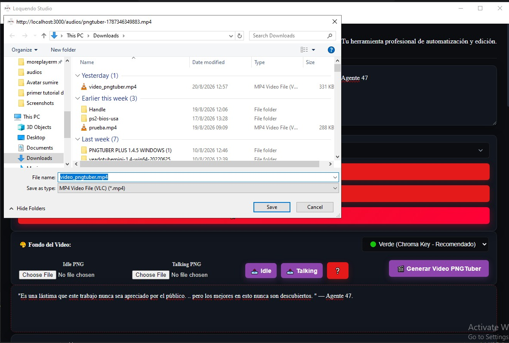

# 🎙️ Loquendo Studio

> **Estabilización 1.2.0:** las fases de desarrollo y regresión están documentadas en [ESTABILIZACION.md](ESTABILIZACION.md). La nueva distribución y la validación de su asar siguen pendientes; los artefactos existentes no se regeneraron durante estas fases.

### Suite profesional de automatización de voz y edición multimedia

[](https://github.com/MayorFabDV/Loquendo-Studio/releases)
[](https://github.com/MayorFabDV/Loquendo-Studio/releases)
[](LICENSE)
[]()

**Convierte texto en audio profesional, genera subtítulos con IA, aplica efectos visuales y crea videos PNGTuber — todo en una sola aplicación offline.**

[Características](#-características) •
[Descarga](#-descarga) •
[Desarrollo](#️-para-desarrolladores) •
[Roadmap](#-roadmap) •
[Licencia](#-licencia)


---

## 📖 Tabla de Contenidos

- [Características Principales](#-características-principales)
- [Stack Tecnológico](#-stack-tecnológico)
- [Vista Previa](#-vista-previa)
- [Descarga](#-descarga)
- [Para Desarrolladores](#️-para-desarrolladores)
- [Estructura del Proyecto](#-estructura-del-proyecto)
- [Cómo Funciona](#-cómo-funciona)
- [Roadmap](#-roadmap)
- [Testers](#-testers)
- [Contribuir](#-contribuir)
- [Licencia](#-licencia)

---

## ✨ Características Principales

### 🎙️ Síntesis de Voz
- **Voces Loquendo**: Jorge, Carlos, Carmen, Diego, Ludoviko, Esperanza, Francisca, Leonor, Soledad, Ximena
- **Voces Microsoft**: Helena, Sabina, David, Zira
- **Voces Acapella**: Diego, Carmen, Jorge
- **Detección automática** de voces instaladas en el sistema
- **SSML completo**: pausas, velocidad, tono, volumen, énfasis, deletreo
- **Multi-voz**: cambia de voz dentro del mismo texto con `[voz:nombre]`
- **Expresiones**: risa, suspiro, grito, llanto, susurro, enojo, felicidad, tristeza, sorpresa, miedo

### 📝 Procesamiento de Texto
- **5 diccionarios personalizables**: jergas, sinónimos, fonética, ortografía, gramática
- **Corrección con LanguageTool** (Java): ortografía, gramática y puntuación
- **Comas inteligentes**: conectores de contraste, causa y enumeración, antes y después
- **Puntos inteligentes**: corta oraciones largas (>30 palabras / >170 caracteres) en puntos de pausa
- **Modos de narración**: Estándar, Creepypasta, Tutorial, Gameplay

### 🎵 Editor de Audio
- **WaveSurfer integrado**: visualización de ondas en tiempo real
- **Recortar**: elimina secciones no deseadas
- **Fade In/Out**: transiciones suaves
- **Normalizar**: volumen consistente
- **Eliminar silencios**: automáticamente
- **Historial**: Deshacer/Rehacer (Ctrl+Z/Ctrl+Y)
- **Atajos**: Espacio, Delete, Ctrl+Z, Ctrl+Y, M
- **Mezclador multipista**: varios clips de voz, música y SFX; dividir, copiar/cortar/pegar, mover, recortar y deshacer/rehacer.
- **Sesión de voz recuperable**: audio y marcadores actuales, original restaurable y ajustes de escucha guardados localmente (mismo perfil/origen).
- **Proyectos**: guardar/abrir en el equipo, recuperar fuentes faltantes, exportar JSON y paquete `.loquendo.tar` con medios incluidos.

### 🎚️ Ducking Inteligente
- **Sidechain compression** con FFmpeg
- **Volumen configurable** de la música
- **Fade In/Out** de la música
- **Loop** para música de fondo
- **Umbral y ratio** ajustables
- **Ocultar automáticamente** la música después de aplicar

### 📄 Subtítulos con IA
- **Whisper.cpp** (C++): transcripción offline sin Python
- **Modelo ggml-small** incluido
- **Subtítulos dinámicos**: 2-15 palabras por línea
- **Formato SRT**: para YouTube, VLC, etc.
- **Formato ASS**: con efectos visuales
- **Sin internet**: 100% offline

### 🎬 Video PNGTuber
- **Imágenes de reposo/habla/parpadeo** con visibilidad exclusiva por expresión
- **Fondos**: verde (chroma key), negro, transparente
- **Renderizado MP4 o WebM con alfa** mediante FFmpeg
- **Listo para OBS/Streamlabs**

### 💾 Exportación
- **WAV** (sin pérdida)
- **MP3** (comprimido)
- **FLAC / Opus / WAV 24-bit** mediante el render avanzado
- **SRT** (subtítulos)
- **ASS** (subtítulos con efectos)
- **MP4** (video PNGTuber)
- **WebM** (PNGTuber con transparencia)
- **JSON / `.loquendo.tar`** (proyecto de mezcla; el TAR incluye los audios referenciados, sin compresión, hasta 2 GiB)

### 🎨 Interfaz
- **Diseño moderno** con iconos SVG
- **Interfaz por pestañas**: Guión → Audio → Video, con barra de flujo y salto automático a Audio al generar
- **Ayudas contextuales**: tooltips en todos los controles (activables/desactivables)
- **Menú Ajustes**: tema oscuro/claro/sistema, ayudas y sonidos de notificación (persistente en localStorage)
- **Tema oscuro/claro**
- **Notificaciones elegantes** (sin alertas)
- **Modales de ayuda y testers**
- **Selector de etiquetas interactivo**
- **Expresiones rápidas**
- **Enlaces externos** en navegador

---

## 🛠️ Stack Tecnológico

| Tecnología | Uso | Lenguaje |
|------------|-----|----------|
| **Electron** | Framework de escritorio | JavaScript |
| **Node.js + Express** | Backend API REST | JavaScript |
| **Python 32 bits** | Síntesis de voz con SAPI | Python |
| **Java + LanguageTool** | Corrección ortográfica | Java |
| **Whisper.cpp** | Transcripción de audio con IA | C++ |
| **FFmpeg** | Procesamiento de audio/video | C |
| **WaveSurfer.js** | Editor de audio | JavaScript |
| **HTML/CSS** | Interfaz | HTML/CSS |

**4 lenguajes integrados**: JavaScript + Python + Java + C++

---

## 🖼️ Vista Previa



---

## 📥 Descarga

### Windows 10/11 (64 bits)

1. Ve a la sección **[Releases](https://github.com/MayorFabDV/Loquendo-Studio/releases)**
2. Descarga el ZIP `LoquendoStudio-v1.2.0-win64.zip`
3. Descomprime el ZIP en una carpeta local (no ejecutes la app desde dentro del ZIP)
4. Ejecuta `Loquendo Studio.exe`

La distribución oficial es la carpeta `win-unpacked` empaquetada en ZIP. No requiere instalador ni Node.js.

**Requisitos:**
- Windows 10/11 (64 bits)
- Loquendo instalado (opcional, para voces Loquendo)
- No requiere Node.js
- No requiere Python
- No requiere Java
- No requiere internet

> Si Windows SmartScreen muestra una advertencia, usa "Más información" → "Ejecutar de todas formas". El ejecutable no está firmado.

---

## 🛠️ Para Desarrolladores

### Requisitos

- [Node.js](https://nodejs.org/) 18+
- [Python](https://python.org/) 3.10+ (32 bits, solo para desarrollo)
- [Java](https://adoptium.net/) 17+ (para LanguageTool)
- Windows 10/11

### Instalación

```bash
# 1. Clonar el repositorio
git clone https://github.com/MayorFabDV/Loquendo-Studio.git
cd Loquendo-Studio

# 2. Instalar dependencias
npm install

# 3. Ejecutar en desarrollo
npm start
```

### Compilación

Antes de empaquetar, revisar el informe de regresión [ESTABILIZACION_FASE5.md](ESTABILIZACION_FASE5.md). Las pruebas disponibles no sustituyen probar la distribución generada.

```bash
# 1. Verificar binarios y módulos requeridos
node scripts/check_build_prereqs.js

# 2. Generar la carpeta win-unpacked
npx electron-builder --win dir

# 3. Crear el ZIP de release
empaquetar_portable.bat
```

Formatos opcionales (no son la distribución oficial):

```bash
npm run build:portable
npm run build:nsis
```

### Pruebas de desarrollo

```powershell
npm test
node scripts/smoke_projects.cjs
node scripts/smoke_projects.cjs --desktop
node scripts/smoke_projects.cjs --sapi
node scripts/smoke_audio_sessions.cjs
node node_modules/electron/cli.js scripts/smoke_mixer.cjs --full-page
node scripts/smoke_native.cjs
```

Los smokes usan perfiles y salidas temporales aislados. `--sapi` requiere la voz Jorge instalada, el ejecutable SAPI y el Python embebido de 32 bits. El smoke nativo usa también Whisper/modelo local y JRE/LanguageTool; no descarga componentes. Consultar el informe para resultados, límites y qué casos usan APIs simuladas.

---

## 📁 Estructura del Proyecto

```text
Loquendo-Studio/
├── backend/
│   ├── bin/                    # Binarios nativos
│   │   ├── ffmpeg.exe          # Procesamiento audio/video
│   │   ├── generar_voz.exe     # Síntesis de voz (32 bits)
│   │   ├── whisper-cli.exe     # Whisper.cpp (IA)
│   │   ├── ggml-small.bin      # Modelo Whisper
│   │   ├── jre/                # Java Runtime Environment
│   │   └── languagetool/       # LanguageTool
│   ├── db/                     # Diccionarios (JSON)
│   ├── modules/                # Scripts Python
│   ├── python/                 # Python 32 bits embebido
│   ├── services/               # Servicios Node.js
│   └── public/                 # Archivos generados
├── frontend/
│   ├── css/                    # Estilos
│   ├── js/                     # Scripts
│   │   ├── core/               # Configuración
│   │   ├── ui/                 # Interfaz
│   │   ├── services/           # Servicios
│   │   └── libs/               # Librerías locales
│   ├── img/                    # Assets
│   └── index.html              # Interfaz principal
├── main-electron.js            # Entry point de Electron
├── server.js                   # API REST
└── package.json
```

---

## 🎯 Cómo Funciona

```text
1. 📝 Escribe o pega tu texto
   ↓
2. ⚙️ Activa opciones (ortografía, gramática, jergas, etc.)
   ↓
3. ✨ Optimiza el texto (diccionarios + puntuación)
   ↓
4. 🔍 Corrige con LanguageTool (opcional)
   ↓
5. 🎙️ Selecciona voz y modo de narración
   ↓
6. 🔊 Genera audio (WAV + SRT/ASS automáticamente)
   ↓
7. ✂️ Edita el audio (cortar, fades, normalizar)
   ↓
8. 🎵 Sube música y aplica Ducking
   ↓
9. 📄 Exporta a MP3
   ↓
10. 🎬 Genera video PNGTuber
```

---

## 🚀 Roadmap

### ✅ v1.0 (Completada)
- ☑ Síntesis de voz con Loquendo
- ☑ Editor de audio con WaveSurfer
- ☑ Ducking con FFmpeg
- ☑ Subtítulos con Whisper.cpp
- ☑ LanguageTool
- ☑ Diccionarios (5 tipos)
- ☑ Video PNGTuber
- ☑ Exportación MP3

### 🔧 v1.0.1 — Parche de Bugs (2026-10-15)
- ☑ [Bug #1] Fix historial Undo/Redo: `historyIndex` desincronizado al llegar a `MAX_HISTORY` causaba Ctrl+Z errático (`audioProcessor.js`)
- ☑ [Bug #2] Fix server exportado como null: `module.exports` se evaluaba antes de que el servidor async arrancara; ahora se expone `getServer()` como getter lazy (`server.js`)
- ☑ [Bug #4] Fix exportar MP3 / ducking con puerto dinámico: `btnDescargar.href` devolvía URL absoluta que fallaba si el puerto cambiaba a 3001/3002; ahora se usa `voiceAudioRealPath` directamente (`main.js`)
- ☑ [Bug #5] Fix usarIA ignorado: el backend hardcodeaba `false` al llamar a `audioService.procesar()`, ignorando el checkbox de subtítulos automáticos; ahora se lee el valor del body (`server.js`)

### 🎨 v1.1 — Nueva Interfaz (2026-10-16)
- ☑ Interfaz por pestañas (Guión → Audio → Video) con barra de flujo y salto automático a Audio al generar el reproductor
- ☑ Sistema de ayudas contextuales: tooltips en todos los controles (`helpSystem.js` + `helpTexts.js`)
- ☑ Menú Ajustes: tema oscuro/claro/sistema, mostrar/ocultar ayudas y sonidos de notificación (persistente en localStorage)
- ☑ Rediseño visual completo de la interfaz (HTML + CSS)
- ☑ Puntuación inteligente mejorada: más conectores (antes y después), comas de énfasis y corte de oraciones largas en puntos de pausa (`TextProcessor.js`)
- ☑ Limpieza de código: lógica de puntuación consolidada en `TextProcessor` (eliminada la duplicada en `main.js`)

### 🔄 v2.0 (En desarrollo)
- □ Migración a Tauri (Rust)
- □ Editor de subtítulos avanzado
- □ Editor de audio avanzado (Tone.js)
- □ Editor de video multipista
- □ Versión Android
- □ Versión iOS

### 🔮 v3.0 (Futuro)
- □ IA generativa de guiones
- □ Clonación de voz
- □ Traducción automática
- □ Publicación automática a YouTube
- □ Colaboración en tiempo real

---

## 🧪 Testers

Gracias a los testers que hicieron posible esta versión:

| Tester | Rol | Canal |
|--------|-----|-------|
| LautyKT | Tester | YouTube |
| Allstarz | Tester | YouTube |
| DarkerGhost | Tester | YouTube |
| Leo | Tester | - |
| CreepyMoxo | Tester | YouTube |

---

## 🤝 Contribuir

¡Las contribuciones son bienvenidas!

1. Fork el proyecto
2. Crea una rama (`git checkout -b feature/NuevaCaracteristica`)
3. Commit tus cambios (`git commit -m 'Añade NuevaCaracteristica'`)
4. Push a la rama (`git push origin feature/NuevaCaracteristica`)
5. Abre un Pull Request

---

## 📄 Licencia

Este proyecto está bajo la licencia **MIT**. Ver el archivo [LICENSE](LICENSE) para más detalles.

---

## 🙏 Agradecimientos

- **Loquendo** por las voces
- **OpenAI** por Whisper
- **LanguageTool** por la corrección ortográfica
- **FFmpeg** por el procesamiento multimedia
- **WaveSurfer.js** por el editor de audio
- **Electron** por el framework
- Mis testers por el feedback

---

Creado con ❤️ por BafYam

[](https://www.youtube.com/@BafYamRevival)
[](https://ko-fi.com/bafyam)

⭐ Si te gusta el proyecto, dale una estrella ⭐
